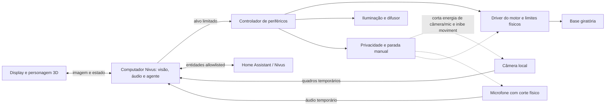
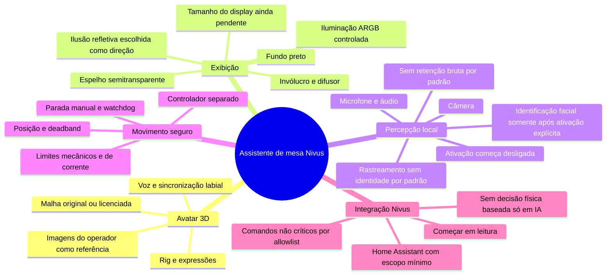

# Assistente virtual de mesa e avatar 3D

**Estado:** proposta de produto em descoberta. Nenhum hardware, modelo de IA ou integração foi selecionado ou implementado.

Este documento separa os detalhes vistos na referência do YouTube da adaptação proposta pelo operador para o Nivus. A descrição e a transcrição do YouTube estavam em dublagem automática quando consultadas em 2026-11-17; nomes técnicos reconhecidos por voz podem conter erros. O vídeo é uma referência de projeto, não uma especificação de compra.

## Referência do vídeo Project NOVA

Fonte: [I Build a REAL Holographic AI Assistant! — DD ElectroTech](https://www.youtube.com/watch?v=WgqDaqqto90). A descrição pública do vídeo menciona display OLED de 5,5 polegadas, computador Orange Pi, PCBs personalizadas e peças impressas em 3D. O modelo exato do Orange Pi não ficou confirmado.

Detalhes apresentados no vídeo e na transcrição automática:

- A imagem de “holograma” é uma ilusão óptica: personagem renderizado sobre fundo preto, display refletivo, cobertura transparente e iluminação controlada. Não é uma imagem volumétrica flutuando livremente.
- O vídeo compara duas experiências iniciais: uma pirâmide de quatro peças transparentes sobre o celular, que exige escurecer o ambiente e cresce demais para um personagem de tamanho real; e uma peça impressa em 3D, cuja imagem só fica correta de um ângulo limitado. A equipe cita o conceito Razer Project AVA como referência para continuar a investigação.
- Uma primeira montagem usou um display de 5,5 polegadas, película/espelho semitransparente, peças impressas, faixa ARGB, difusor em meia-lua e cilindro transparente. O protótipo inicial conectava o display a um laptop por HDMI.
- Para o ângulo de visão, a equipe descreve uma base giratória com rolamentos, motorredutor e potenciômetro acoplado por engrenagem para medir posição. O texto automático cita cinco rolamentos; a contagem deve ser conferida no vídeo antes de reproduzir a mecânica.
- O vídeo mostra uma câmera USB e um computador Orange Pi para processamento embarcado. A descrição menciona rastreamento facial e das mãos; a transcrição também fala em reconhecimento de objetos.
- A equipe relata calibração entre posição do rosto, ângulo do display e posição do motor. O ajuste final evita girar a tela para pequenas mudanças: perto do aparelho, o personagem altera a pose; mais longe, a base acompanha a pessoa.
- O criador relata três PCBs: duas para iluminação endereçável e uma placa de controle para LEDs, alto-falante, motor e comunicação com o computador, incluindo a manutenção do ângulo do display. Antes das placas finais, testou o circuito e o feedback de posição em protoboard.
- As peças do invólucro foram impressas, montadas e ajustadas por tentativa e erro antes da versão final.
- A descrição e a demonstração incluem conversas por voz, respostas sobre objetos e ambiente, controle de luz/ar-condicionado, música, personagens 3D, animações, expressões e um aplicativo Android para escolher personagem, controlar luz e ligar/desligar rastreamentos.
- Na demonstração, a assistente comenta a aparência do usuário, identifica um multímetro e pergunta sobre o trabalho em andamento; depois ajusta luz e ar-condicionado por pedido e inicia música. Isso demonstra a interface apresentada no vídeo, mas não comprova a segurança do controle de aparelhos.
- O áudio usa alto-falante e controle físico de volume. Um interruptor físico corta a alimentação da câmera e do microfone.
- O criador informa que os personagens 3D foram desenhados pela equipe. Esses modelos são conteúdo próprio do vídeo e não fazem parte dos arquivos de referência do Nivus.

### Referências de peças e conjuntos mostrados

O vídeo ajuda a identificar categorias e alguns parâmetros, mas não fornece uma BOM completa, códigos de fabricante, links de compra, esquemas elétricos nem especificações suficientes para copiar a montagem sem validação.

| Peça/conjunto | Referência citada ou mostrada | O que ainda não foi identificado |
| --- | --- | --- |
| Display | OLED de 5,5 polegadas; protótipo inicial ligado a um laptop por HDMI | Fabricante, modelo, resolução, brilho e interface da unidade final |
| Computador embarcado | Orange Pi | Modelo exato, RAM, armazenamento e acelerador; o nome ouvido na transcrição automática não é confiável o bastante para fixar uma versão |
| Conjunto óptico | Película/espelho semitransparente, cilindro/cobertura transparente, fundo preto e difusor em meia-lua | Material, espessura, dimensões, geometria e tratamento óptico |
| Iluminação | Faixa ARGB endereçável | Tipo/quantidade de LEDs, tensão, corrente, controlador e difusão final |
| Câmera | Câmera USB para acompanhar a pessoa | Fabricante, sensor, lente, resolução e campo de visão |
| Base motorizada | Motorredutor, base giratória e rolamentos; a transcrição menciona cinco rolamentos, contagem a confirmar | Modelo e relação do motor, quantidade/tipo de rolamentos, torque, velocidade e limites mecânicos |
| Feedback de posição | Potenciômetro ligado por engrenagem ao mecanismo | Modelo, curso, resolução, montagem e calibração |
| Eletrônica de controle | Três PCBs relatadas: duas para LEDs e uma para controle/comunicação de LEDs, alto-falante e motor | Esquemas, componentes, microcontrolador, drivers, conectores e arquivos das placas |
| Áudio | Alto-falante e controle físico de volume | Modelos, potência, amplificador e microfone usado na versão final |
| Protótipos ópticos | Pirâmide de quatro peças transparentes sobre um celular e peça refletiva impressa em 3D | Material e medidas exatos; foram experiências iniciais, não a solução final |

O vídeo descreve um motorredutor com realimentação por potenciômetro; isso não confirma o uso de motor de passo na proposta Nivus. Esses dados servem para orientar pesquisa e prototipagem, não para emitir uma lista de compras.

## Adaptação proposta pelo operador

O operador descreveu uma assistente de mesa com tela, efeitos de iluminação, motor de passo, ESP32-CAM, microfone e um computador para processar imagem e áudio, acompanhar a pessoa, reconhecer rostos e atender comandos. Essa é a lista da proposta do Nivus; o vídeo, por sua vez, descreve câmera USB, motorredutor com feedback de posição e Orange Pi. Os componentes não devem ser tratados como equivalentes até que a seleção seja feita.

Preferências já definidas pelo operador: usar uma exibição refletiva inspirada no Project NOVA; combinar o traje azul-marinho/dourado com elementos steampunk; permitir identificação facial somente após ativação explícita. A ativação deve começar desligada. O tamanho da tela, o método dessa ativação e a política de processamento/armazenamento ainda não foram definidos.

O computador principal poderá ser o host Nivus disponível, mas o desempenho ainda precisa ser medido. O microcontrolador deve cuidar de periféricos e movimento; visão computacional, áudio e agente conversacional ficam em um processo substituível. A primeira integração com Home Assistant/Nivus deve ser somente de leitura e usar uma allowlist estreita para comandos posteriores.

## Análise das referências de software e produto

Revisão dos repositórios e da página pública em 17/11/2026. Os três repositórios chamados “Project Nova/NOVA” são projetos distintos; não há evidência de que compartilhem autoria ou implementação. A página da Razer é referência comercial, não documentação de engenharia.

| Fonte | O que a fonte mostra | O que pode orientar o Nivus | Limites para esta decisão |
| --- | --- | --- | --- |
| [Navjot-Singh7/Project-Nova](https://github.com/Navjot-Singh7/Project-Nova) | Companheiro local em Python para Windows: Ollama, modelo conversacional fine-tuned, roteador de ferramentas, memória ChromaDB, Moonshine ASR, Soprano TTS, resposta estruturada com emoção e animação de avatar via VMC/VSeeFace. O README declara RTX 2050 com 4 GB de VRAM como alvo mínimo. O código de visão abre a webcam e captura um quadro quando acionado; há captura de tela por solicitação. | Separar reconhecimento de fala, diálogo, ferramentas, memória e renderização; usar contrato estruturado entre diálogo e expressões do avatar; começar visão por solicitação e quadro único, em vez de gravação contínua. | Não comprova execução em Ubuntu, Raspberry Pi 3 ou CPU sem GPU NVIDIA; o alvo documentado é Windows com CUDA e GPU dedicada. A ferramenta `delete_files` envia Ctrl+A/Delete à janela ativa do Explorer sem confirmação explícita no código analisado; não transportar essa ação nem um executor arbitrário para o Nivus. O bot opcional do Discord amplia a superfície de exposição e exige isolamento de usuários/memórias. O repositório tem licença MIT; isso não licencia automaticamente modelos ou assets de terceiros usados por ele. |
| [PradeepaRW/project-nova](https://github.com/PradeepaRW/project-nova) | Exporta workflows n8n que roteiam mensagens para agentes e servidores MCP, incluindo Home Assistant. O README descreve 25 agentes, n8n e MCP; a árvore também contém workflows, Dockerfiles e configurações de exemplo. | Ideias de roteamento por capacidade e de integração através de adaptadores pequenos, substituíveis e documentados. | É uma arquitetura de automação de software, não o firmware ou o projeto óptico de um assistente de mesa. No material inspecionado, o trigger de chat aparece público e o servidor CLI permite comandos amplos: `privileged: true`, montagem de `/var/run/docker.sock`, `ALLOWED_COMMANDS=all` e operadores de shell habilitados. Essa combinação pode entregar controle administrativo do host; não implantar esses arquivos no Nivus sem redesenho e revisão de segurança. O README declara MIT, mas não foi localizado `LICENSE` na árvore consultada; confirmar antes de reutilizar código. |
| [dujonwalker/project-nova](https://github.com/dujonwalker/project-nova) | O README da versão 2 define o projeto como catálogo agnóstico de cliente com 25 servidores MCP e 25 pacotes de skills opcionais; declara que não é assistente, chat, roteador central nem runtime de orquestração. Streamable HTTP em `/mcp` é a referência onde suportado. | Manter conectores e instruções de capacidade separados, para que clientes diferentes possam consumir as mesmas ferramentas sem instalar todo o ecossistema em cada nó. | Não implementa avatar, interação por voz nem hardware de mesa. Não adotar 25 serviços por padrão; selecionar somente os adaptadores necessários. Não foi localizado arquivo de licença na árvore consultada, então usar como referência de organização, sem copiar código até confirmar os termos. |
| [Razer AVA — página oficial](https://www.razer.com/br-pt/razer-ava) | A página anuncia um avatar animado de 5,5 polegadas, câmera, microfone, alto-falante, interação com o ambiente e análise da tela do PC via ligação USB-C a Windows. A página informa beta e previsão de lançamento no segundo semestre de 2026. | Inspira a experiência de produto: presença física e de desktop, personagem expressivo, voz e visão sob demanda numa mesma assistente. O valor de 5,5 polegadas serve apenas como referência inicial de escala, junto ao protótipo do vídeo. | A página não informa a construção óptica, a lista de materiais, esquemas ou políticas técnicas de retenção. “Holograma” é a descrição de produto; não comprova projeção volumétrica nem revela a solução interna. A disponibilidade e os recursos descritos são declarações da fabricante e não validação independente. |

### Decisões de arquitetura derivadas

- Separar captura de câmera/microfone, processamento de percepção, agente de conversa, memória, saída de voz/avatar e controle de periféricos. Trocar o modelo de IA não deve exigir trocar a tela ou o controlador do motor.
- Preferir captura visual por solicitação ou eventos locais claros; rastreamento de posição não precisa identificar uma pessoa. A identificação facial começa desligada e só pode rodar depois de uma ativação explícita, com consentimento, cancelamento e regras de retenção definidos.
- Passar do modelo para o renderizador apenas estados tipados e limitados — por exemplo, fala, expressão, pose e duração. Ferramentas ficam em catálogo explícito com parâmetros validados; nenhuma resposta de modelo vira shell, exclusão de arquivo ou comando irrestrito.
- A primeira integração residencial permanece em leitura. Comandos posteriores exigem allowlist e confirmação, e nunca deixam decisões críticas de segurança a cargo de voz, reconhecimento facial ou previsão da IA.
- Fazer o primeiro protótipo de percepção/voz num host x86_64 com recursos medidos. O projeto da Navjot não comprova o perfil Raspberry Pi 3; câmera, áudio e inferência têm requisitos diferentes e devem ser medidos por separado.
- Tratar as três fontes GitHub como referências de padrões e interfaces, não como componentes aprovados para instalação. Verificar licenças, dependências, exposição de rede e permissões antes de qualquer reuso.

## Base visual para o modelo 3D

As imagens fornecidas pelo operador serão referências visuais para o avatar 3D, não para a eletrônica. A direção principal escolhida combina o traje azul-marinho com linhas douradas, cabelo curto escuro/azul, calça escura e botas altas com elementos steampunk das outras referências: gola/ombros estruturados, couro, fivelas, braceletes e ferragens metálicas. O objetivo é um único traje coeso, com desenho original, e não alternar entre dois personagens separados.

Para a criação do personagem, o pacote de arte deverá definir uma malha original ou licenciada, vistas ortográficas consistentes, escala, rig de cabeça/olhos/corpo, expressões, poses, gestos e sincronização labial. A resolução, o formato de exportação e o pipeline 3D ainda estão em aberto. As imagens não foram copiadas para este repositório; a origem e os direitos de uso precisam ser confirmados antes de publicar arte derivada ou distribuir o modelo.

O personagem na tela deve renderizar sobre fundo preto para apoiar a ilusão refletiva do display. A forma de tela, a película semitransparente e o difusor precisam ser testados juntos; uma tela comum em uma pirâmide de acrílico não garante a mesma imagem fora de um ângulo restrito.

## Mapa mental

## Privacidade, segurança e falhas

- Rastreamento de posição no quadro é o padrão inicial. O operador escolheu permitir reconhecimento facial de identidade somente quando explicitamente ativado; ele começa desligado. Ainda falta decidir como ativar, como registrar consentimento, quais identidades podem ser cadastradas e como revogar/excluir esses dados.
- Processamento local e ausência de gravação bruta por padrão são propostas de privacidade, ainda sem confirmação final. A política de quadros, áudio, embeddings faciais, transcrições, métricas, acesso e retenção precisa ser definida antes de implementar a identificação.
- Requisito físico proposto: um interruptor deve cortar a alimentação da câmera e do microfone e indicar claramente quando estão ativos. A necessidade e o desenho desse corte ainda aguardam confirmação do operador; botão de software sozinho não oferece isolamento físico.
- A perda do host, da rede, do heartbeat ou da posição deve interromper o movimento sem uma rotação corretiva inesperada. O controlador local aplica velocidade, curso e corrente máximos; incluir parada manual, watchdog e proteção contra aprisionamento.
- Reconhecimento facial, inferência ou voz não podem, isoladamente, destrancar portas, abrir portões, desligar alarmes ou controlar cargas críticas. Comandos comuns passam por allowlist determinística, confirmação adequada e registro sem conteúdo de voz.
- Começar com display/avatar e leitura somente. Câmera, movimento e controle doméstico entram em etapas separadas, primeiro simuladas e depois em dispositivos não críticos.

## Etapas e decisões em aberto

1. Transformar as referências visuais em um brief e modelo 3D original/licenciado, sem sensores nem movimento.
2. Testar display, reflexo, iluminação e difusor em uma estrutura estática; registrar o ângulo de visão útil e a legibilidade em ambiente iluminado.
3. Selecionar câmera e plataforma de processamento; medir detecção/rastreamento sem identificação. Especificar ativação explícita, consentimento, processamento local/remoto e retenção antes de habilitar reconhecimento facial.
4. Selecionar motor, driver, feedback de posição e estrutura; validar deadband, curso limitado, ruído, temperatura e parada manual.
5. Adicionar microfone/alto-falante com corte físico e interação local; só depois integrar comandos de baixo risco ao Home Assistant/Nivus.

Ainda precisam de decisão: tamanho/modelo do display; câmera USB ou ESP32-CAM; placa/controlador de motor; tipo de motor e feedback; microfone/alto-falante; computador e modelos locais; tecnologia de reconhecimento de fala/visão; ativação e gestão de consentimento para identidade facial; processamento local/remoto e retenção; corte físico dos sensores; dimensão e material do invólucro; formatos do modelo 3D; entidades domésticas permitidas.
