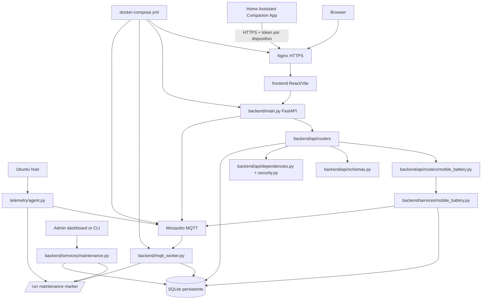
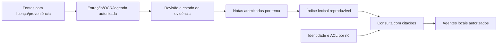

# Mapa de módulos e dependências

Este mapa distingue o que existe do que está planejado. Os caminhos são relativos à raiz do repositório.

## Nó de borda atual



### Fronteiras

| Módulo | Entrada/saída | Responsabilidade |
| --- | --- | --- |
| `telemetry/` | métricas do host → MQTT | Coleta CPU, memória, disco, energia estimada e sensores disponíveis; não implementa a política da API. |
| `backend/api/routers/` | HTTP autenticado ↔ schemas | Endpoints por domínio; exige autorização nas rotas sensíveis. |
| `backend/api/routers/mobile_battery.py` | Admin JWT + relatório tokenizado | Admin cadastra/revoga; celular envia somente percentual e horário. O cliente não escolhe tópico nem comando. |
| `backend/services/mobile_battery.py` | Leitura móvel validada → regra + auditoria MQTT | Rejeita leituras antigas/repetidas; publica somente `OFF` em `nivus/edge/relay1` a ≤20%; recuperação acima de 20% rearma sem enviar `ON`. |
| `backend/services/` | chamadas internas ↔ serviços | MQTT, logs e operações de domínio; não expõe portas diretamente. |
| `backend/database.py` | conexões ↔ SQLite | Persistência, migrações aditivas e consultas. |
| `backend/mqtt_worker.py` | MQTT → validação/persistência | Consome telemetria e registra alertas de regra determinística. |
| `backend/services/maintenance.py` | Admin API/CLI → estado volátil + audit SQLite | Alterna coleta em background com allowlist; o marcador desaparece no reboot. |
| `deploy/nivusctl` | terminal → maintenance service | Expõe `nivus help` e ações `maintenance enable|disable|status`; escrita exige sudo. |
| `frontend/src/` | API ↔ componentes React | Login e dashboard; não decide segurança de backend. |
| `deploy/` e `docker-compose.yml` | arquivos de configuração → processos | Instalação, redes, volumes, health, backup e rollback. |

Consulte [`ARCHITECTURE.md`](ARCHITECTURE.md), [`PROJECT_STATUS.md`](PROJECT_STATUS.md) e os arquivos de cada módulo antes de mudar contratos. O mapa não substitui o código.

## Biblioteca compartilhada futura



`knowledge/catalog/` e `knowledge/topics/` são conteúdo público curado. Extração, indexação lexical executável, consulta na aplicação e replicação autenticada em vários nós ainda são trabalho da Fase 4.

## Paralelismo externo de desenvolvimento (fora do runtime)

```text
GitHub Issue aprovada (ai:ready)
  → controlador leve opcional no notebook
  → runner efêmero GitHub-hosted
  → agente/modelo em sandbox
  → PR → CI → homologação → revisão humana/merge
```

O intake GitHub existe; o controlador no notebook, worker, provedor de modelo e sandbox ainda não foram implementados. Hermes/OmniRoute/Discord/Jira são opções de ferramentas externas, não serviços do nó Nivus. O executor não depende do agente de telemetria nem do Nó Master. Ver [`AI_DEVELOPMENT_ORCHESTRATION.md`](AI_DEVELOPMENT_ORCHESTRATION.md).

## Scheduler Nivus entre nós (futuro)

```text
identidade de nó → inventário de capacidade → fila/lease → worker isolado
                → artefato com checksum → validação/aceite → auditoria
```

Esse scheduler não está implementado. A Fase 2 fornece cadastro/heartbeat e a Fase 5 define leases, idempotência, quotas, cancelamento e recuperação. Compartilhar um arquivo ou GPU pela LAN não agrega RAM/VRAM por si só.
