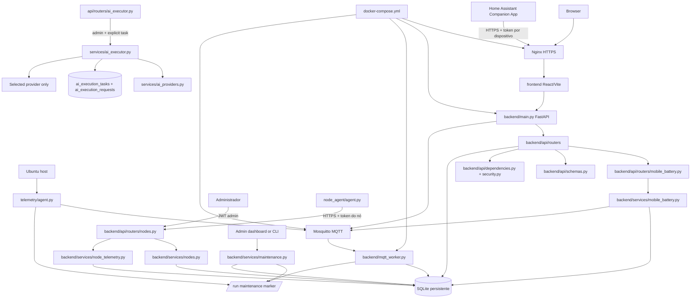
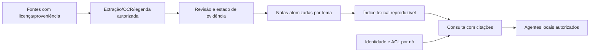

# Mapa de módulos e dependências

Este mapa distingue o que existe do que está planejado. Os caminhos são relativos à raiz do repositório.

## Nó de borda atual



### Fronteiras

| Módulo | Entrada/saída | Responsabilidade |
| --- | --- | --- |
| `telemetry/` | métricas do host → MQTT | Coleta CPU, memória, disco, energia estimada e sensores disponíveis; não implementa a política da API. |
| `backend/api/routers/` | HTTP autenticado ↔ schemas | Endpoints por domínio; exige autorização nas rotas sensíveis. |
| `backend/api/routers/mobile_battery.py` | Admin JWT + relatório tokenizado | Admin cadastra/revoga; celular envia somente percentual e horário. O cliente não escolhe tópico nem comando. |
| `backend/api/routers/nodes.py` | Admin JWT ou credencial própria do nó | Pareamento one-use, sessão, heartbeat ordenado, listagem e revogação; a candidata inclui ingestão e histórico protegido da telemetria do nó. Não executa operações remotas. |
| `backend/services/nodes.py` | Contratos validados ↔ SQLite | Cria IDs no servidor, persiste somente hashes de códigos/tokens, deriva estado pelo heartbeat e restringe capacidades a uma allowlist; integrado pelo PR #66. |
| `backend/services/node_telemetry.py` | Envelope validado ↔ tabelas do registro | Valida métricas, unidades, faixas, qualidade, sessão e sequência; armazena por `node_id`, limita lotes novos a 1/30 s por nó, permite histórico somente admin e remove lotes/amostras vencidos tanto na ingestão quanto na consulta (inclusive para nó offline). O PR #97 pagina até 500 lotes, limita offset e mantém snapshot ISO 8601 estável; CI aprovada, integração pendente. |
| `node_agent/agent.py` + `node_agent/telemetry.py` | CLI pareamento/run ↔ API de nós | PR #69 adiciona identidade/heartbeat. A candidata local envia CPU, memória e disco via HTTPS com sequência compartilhada, retry idempotente e leituras indisponíveis explícitas; limita a telemetria a 1/30 s mesmo com heartbeat mais rápido. Sem comandos ou ações remotas; smoke físico pendente. |
| `backend/services/mobile_battery.py` | Leitura móvel validada → regra + auditoria MQTT | Rejeita leituras antigas/repetidas; publica somente `OFF` em `nivus/edge/relay1` a ≤20%; recuperação acima de 20% rearma sem enviar `ON`. |
| `backend/services/` | chamadas internas ↔ serviços | MQTT, logs e operações de domínio; não expõe portas diretamente. |
| `backend/api/routers/ai_executor.py` + `backend/services/ai_executor.py` | tarefa explícita → provedor selecionado | Executor runtime integrado pelo PR #82; classe de dados, orçamento, timeout, cancelamento e auditoria mínima; sem retry, fallback ou execução do resultado. CI hospedada aprovada; implantação no notebook pendente. |
| `telemetry/power_policy.py` + `deploy/nivus-performance-policy.*` | fonte AC/NUT → governor CPUFreq | Candidato opt-in; fonte falha/ambígua usa governor conservador; escrita limitada a `scaling_governor`; sem ação em atuadores/overclock. Issue #62 aguarda CI/revisão. |
| `backend/database.py` | conexões ↔ SQLite | Persistência, migrações aditivas e consultas. |
| `backend/mqtt_worker.py` | MQTT → validação/persistência | Consome telemetria e registra alertas de regra determinística. |
| `backend/services/maintenance.py` | Admin API/CLI → estado volátil + audit SQLite | Alterna coleta em background com allowlist; o marcador desaparece no reboot. |
| `deploy/nivusctl` | terminal → maintenance service | Expõe `nivus help` e ações `maintenance enable|disable|status`; escrita exige sudo. |
| `frontend/src/` | API ↔ componentes React | Login e dashboard; não decide segurança de backend. |
| `deploy/` e `docker-compose.yml` | arquivos de configuração → processos | Instalação, redes, volumes, health, backup e rollback. |

Consulte [`ARCHITECTURE.md`](ARCHITECTURE.md), [`PROJECT_STATUS.md`](PROJECT_STATUS.md) e os arquivos de cada módulo antes de mudar contratos. O mapa não substitui o código.

## Biblioteca compartilhada futura



`knowledge/catalog/` e `knowledge/topics/` são conteúdo público curado. Extração, indexação lexical executável, consulta na aplicação e replicação autenticada em vários nós ainda são trabalho da Fase 4.

## Paralelismo externo de desenvolvimento (fora do runtime)

```text
GitHub Issue aprovada (ai:ready)
  → intake GitHub Actions valida escopo e autorização
  → runner efêmero GitHub-hosted executa modelo e worker limitado
  → draft PR → CI → revisão humana → merge/deploy
```

O intake GitHub Issues/Actions, a chamada de modelo autorizada e o worker limitado executado em runner GitHub-hosted existem. Uma chamada para a issue pública/sintética #6 criou o draft #16; a abertura automática falhou naquela execução por ausência de checkout. O commit `bec9573` corrigiu a leitura da branch padrão pela API, e o PR #53 adicionou proteção contra propostas duplicadas, limpeza dos rótulos da fila e comentário com o link do draft. Ainda não houve nova chamada autorizada para confirmar o ciclo automático após essas correções; o PR #16 continua draft e exige revisão humana. O worker não faz merge nem deploy.

O PR #18 propõe um runner opcional no notebook para checks confiáveis da branch principal, mas continua draft, não está integrado nem instalado e não substitui os runners hospedados. Não há controlador persistente no notebook nem integração ativa com Discord, Jira, Hermes ou OmniRoute. Este executor de desenvolvimento não depende da telemetria local ou do Nó Master. Ver [`AI_MODULE_WORKPLAN.md`](AI_MODULE_WORKPLAN.md), [`AI_EXECUTOR_IMPLEMENTATION.md`](AI_EXECUTOR_IMPLEMENTATION.md) e [`AI_DEVELOPMENT_ORCHESTRATION.md`](AI_DEVELOPMENT_ORCHESTRATION.md).

## Scheduler Nivus entre nós (futuro)

```text
identidade de nó → inventário de capacidade → fila/lease → worker isolado
                → artefato com checksum → validação/aceite → auditoria
```

Esse scheduler não está implementado. A Fase 2 fornece cadastro/heartbeat e a Fase 5 define leases, idempotência, quotas, cancelamento e recuperação. Compartilhar um arquivo ou GPU pela LAN não agrega RAM/VRAM por si só.

O executor runtime da issue #74 é separado do dispatcher GitHub Actions e do futuro scheduler distribuído. Ele opera em uma solicitação administrativa explícita para o provedor selecionado; não distribui tarefas entre nós.
