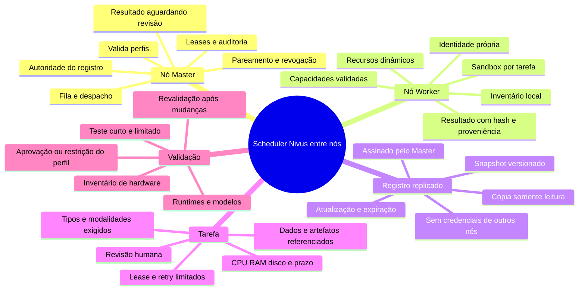
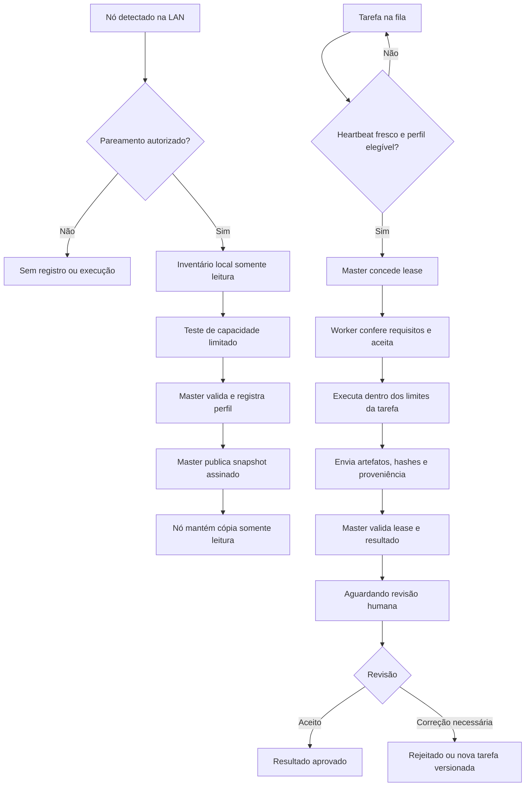

# Capacidades dos nós e scheduler distribuído

**Estado: proposta arquitetural; não implementada.** Este documento detalha o requisito do operador para workers heterogêneos na rede Nivus. O fluxo de Issues/GitHub Actions que prepara PRs de desenvolvimento é separado deste scheduler do produto.

## Objetivo e requisitos do operador

Cada nó Nivus deve aceitar somente tarefas compatíveis com suas capacidades validadas. Ao ingressar, um nó é analisado e registrado pelo Nó Master; o novo nó recebe uma cópia do registro da frota. O scheduler direciona a tarefa a um worker elegível e devolve o resultado para revisão humana.

Os exemplos iniciais do operador são hipóteses de perfil, não compatibilidade já comprovada:

- Raspberry Pi 3: tarefas de texto, sem capacidades de imagem/áudio/vídeo.
- Dell Vostro 3268: texto, cálculos e programação simples.

O nome do equipamento não habilita uma capacidade automaticamente. Cada classe precisa de evidência no equipamento e na configuração reais, incluindo runtime/modelo, memória disponível e desempenho sustentado.

## Mapa mental



## Mapa do fluxo



A descoberta na LAN serve apenas para ajudar o operador a encontrar o equipamento. Estar na mesma rede não autentica nem autoriza um nó.

## Registro e perfil de capacidade

O registro atual fornece identidade, pareamento, revogação e heartbeat. A extensão planejada deve separar três conceitos:

1. **Identidade do nó:** ID atribuído pelo servidor, credencial própria armazenada como hash no Master, sessão rotativa, sequência contra replay e estado de revogação.
2. **Capacidade validada (relativamente estática):** arquitetura, memória, aceleradores, sensores relevantes, runtimes/modelos instalados, tipos de tarefa suportados, versões e evidência de validação.
3. **Disponibilidade (dinâmica):** memória livre, carga, temperatura, espaço de trabalho, alimentação e concorrência atual. Heartbeats atualizam essa disponibilidade sem transformar medidas instantâneas em capacidades permanentes.

O agente pode coletar inventário de forma local e limitada. O Master valida o esquema e a identidade; um teste curto, com recursos e tempo limitados, verifica cada capacidade. Perfis começam como `pending`; o Master marca capacidades individualmente como `validated`, `restricted` ou `rejected`. A ausência de teste mantém a capacidade indisponível.

Uma futura representação de perfil deve ter versão de esquema e revisão, por exemplo:

- `node_id`, `profile_revision`, `reported_at`, versão do agente, SO e arquitetura;
- capacidades nomeadas e sua origem/evidência;
- runtime, modelo, versão, modalidade de entrada, limite de contexto e recursos mínimos quando houver inferência;
- limites de concorrência, CPU, RAM, disco, prazo e temperatura para cada classe;
- estado de validação e data da última validação.

Capacidades devem ser granulares. “Texto” pode incluir inferência, classificação ou sumarização; cálculo determinístico e geração de código são capacidades distintas. Geração de código e execução de código também são permissões separadas. Cada worker recusa localmente uma tarefa que exceda seu perfil, mesmo que o Master a tenha enviado por engano.

## Cópia do registro nos nós

O Master é a fonte autoritativa. Após o pareamento, ele envia ao nó um snapshot versionado e assinado com os campos necessários para identificar workers, capacidades validadas, estado e frescor do heartbeat.

- A cópia é somente leitura para workers; alterações de identidade, capacidade, permissão e revogação passam pelo Master.
- Snapshots contêm IDs, perfis e estado operacional, nunca tokens, chaves privadas, hashes de credenciais ou dados de tarefas de outros nós.
- O nó verifica assinatura, versão, integridade e expiração antes de usar a cópia. A distribuição pode ocorrer por HTTPS autenticado, no pareamento e em sincronizações posteriores.
- Revogações incrementam a revisão do registro. Snapshots antigos expiram; um cache local não autoriza novos leases quando o Master está indisponível.
- Nós podem exibir o último catálogo conhecido durante uma partição, identificado como desatualizado. A execução já concedida termina apenas dentro do lease; novas atribuições aguardam o Master.

A cópia permite descoberta e consistência do catálogo, mas não cria vários Masters nem consenso distribuído.

## Seleção e execução da tarefa

Uma tarefa declara ID idempotente, tipos/capacidades exigidos, modalidade de entrada, recursos e prazo, classificação de dados, limites de tamanho, referências de artefatos com hash, política de retry e critérios de aceitação.

O Master seleciona apenas nós que estejam registrados e não revogados, com heartbeat dentro do limite, perfil validado compatível e recursos dinâmicos suficientes. Entre candidatos elegíveis, pode priorizar menor carga, menor custo de energia ou fairness; essas preferências nunca relaxam requisitos obrigatórios.

A concessão usa uma lease com nó responsável, prazo e token/versão de fencing. Workers renovam a lease durante execução; expiração libera a tarefa para retry limitado. O ID idempotente, a versão da lease e a validação de hash impedem aceitar resultados tardios ou duplicados. Cancelamento, partição, reinício do Master ou worker indisponível deixam estado auditável e recuperável.

```text
queued -> leased -> running -> result_pending_review -> accepted
                         |                         -> rejected
                         +-> retry_wait -> queued
                         +-> failed / cancelled / expired
```

O worker executa entradas e saídas somente na sandbox da tarefa, com CPU/RAM/disco limitados, sem acesso geral ao host, segredos, rede ou atuadores. A transferência de artefatos usa HTTPS autenticado e hashes. O Master valida formato, tamanho, hash, proveniência e correspondência com a lease antes de marcar `result_pending_review`.

A revisão mostra diff/artefatos, worker, perfil usado, versões de runtime/modelo, checks e tentativas. Aprovação humana é uma etapa explícita; o scheduler não faz merge, deploy nem aciona dispositivos físicos.

## Limites e falhas

- Não usar hostname, IP ou anúncio de capacidade do próprio worker como identidade ou prova suficiente.
- Não executar tarefas de controle em tempo real nem decisões de segurança física nesta fila.
- Não aceitar credenciais, telemetria doméstica, imagens privadas ou dados pessoais sem política de dados explícita.
- Heartbeat atrasado, relógio incorreto, perfil obsoleto e capacidade sem validação tornam o nó inelegível.
- Reinício do coordenador deve reconstruir fila e leases do armazenamento durável; SQLite é uma escolha a avaliar pela concorrência e volume medidos, não uma premissa.
- Retry é limitado e não pode repetir efeitos externos. Resultados precisam carregar hashes, versões e proveniência.
- O conjunto de nós não agrega automaticamente RAM/VRAM para executar um único modelo; paralelismo de modelo exige suporte específico e medições.

## Entregas e critérios de aceitação

### Etapa A — Perfil validado e registro replicado

- Estender schemas, migrações e agente para reportar inventário e evidências de capacidades sem alterar a identidade atual.
- Aprovar capacidades separadamente; validar pareamento, rotação/revogação e mudanças de perfil.
- Distribuir snapshots assinados, versionados e expirados; testar integridade, nó revogado e cache desatualizado.
- Demonstrar onboarding físico primeiro no Raspberry Pi 3 e no Dell Vostro 3268, registrando versões e resultados sem publicar dados privados.

### Etapa B — Scheduler e lease

- Implementar contratos de tarefa, seleção por capacidades obrigatórias, reserva dinâmica e leases com fencing.
- Testar duplicidade, worker desconectado, lease expirada, cancelamento, retry, relógio incorreto, reinício do Master e recurso insuficiente.
- Confirmar que worker incompatível ou revogado não recebe tarefa nova.

### Etapa C — Resultado e revisão

- Transferir artefatos por HTTPS com hash e proveniência.
- Criar estado de resultado aguardando revisão e uma superfície para inspecionar, aceitar ou rejeitar.
- Testar rejeição, nova tentativa e preservação do resultado anterior; nenhuma aceitação ou implantação automática.

A primeira entrega é uma proposta de arquitetura e não declara essas capacidades implementadas. Fase 2 precisa concluir validação física e perfil/registro; a Fase 5 depende da identidade confiável, inventário e regras de recursos definidos aqui.

## Relação com o fluxo GitHub de desenvolvimento

A fila Issues/GitHub Actions chama um modelo e prepara um PR para revisão do código. Este scheduler coordena workloads entre computadores Nivus e devolve artefatos ao Master para revisão. São fluxos distintos, com identidades, permissões, dados e critérios de aceite próprios.
