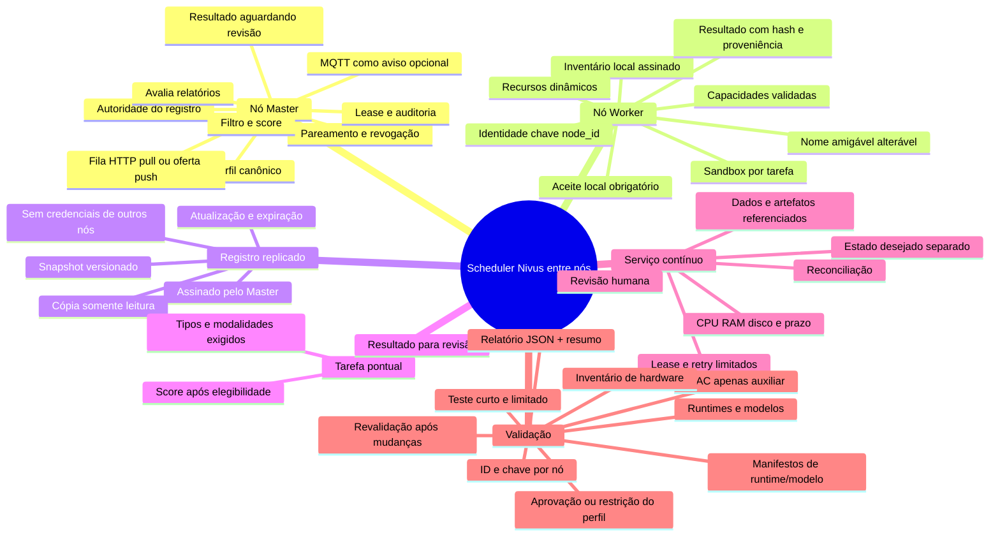
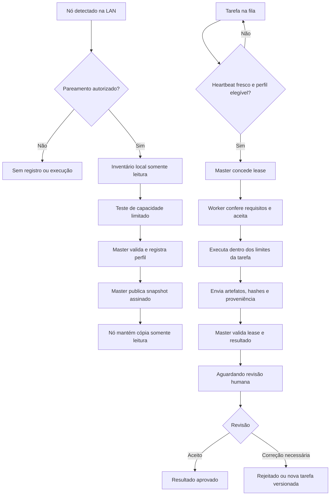

# Capacidades dos nós e scheduler distribuído

**Estado: proposta arquitetural; não implementada.** Este documento detalha o requisito do operador para workers heterogêneos na rede Nivus. O fluxo de Issues/GitHub Actions que prepara PRs de desenvolvimento é separado deste scheduler do produto.

## Objetivo e requisitos do operador

Cada nó Nivus deve aceitar somente tarefas compatíveis com suas capacidades validadas. Ao ingressar, um nó é analisado e registrado pelo Nó Master; o novo nó recebe uma cópia do registro da frota. O scheduler direciona a tarefa a um worker elegível e devolve o resultado para revisão humana.

Os exemplos iniciais do operador são hipóteses de perfil, não compatibilidade já comprovada:

- Raspberry Pi 3: tarefas de texto, sem capacidades de imagem/áudio/vídeo.
- Dell Vostro 3268: texto, cálculos e programação simples.

O nome do equipamento não habilita uma capacidade automaticamente. Cada classe precisa de evidência no equipamento e na configuração reais, incluindo runtime/modelo, memória disponível e desempenho sustentado.

## Nome, identidade e vínculo com o equipamento

Na primeira inicialização, o instalador pode atribuir um nome amigável aleatório, por exemplo `nivus-cobre-7f2a`. O operador poderá renomeá-lo na tela de nós do Master; o rótulo é replicado no catálogo. Por padrão, isso não altera o hostname do Ubuntu nem exige acesso root remoto. Uma mudança do hostname do sistema seria uma operação local separada, com confirmação e registro. O nome é apenas um rótulo: pode repetir, mudar e nunca será usado como credencial.

A identidade de segurança usa o `node_id` atribuído pelo Master no pareamento e uma chave exclusiva gerada pelo nó. O nó assina os relatórios; o Master verifica a assinatura e associa o conteúdo à identidade registrada. Se houver TPM 2.0, a chave privada poderá ser protegida pelo TPM; o fluxo base precisa funcionar sem TPM. A chave de Endorsement do TPM identifica o próprio TPM, não substitui uma identidade de dispositivo provisionada.

**O MAC é viável como dado auxiliar de inventário e reconciliação, mas não como identidade única nem prova de autorização.** Um nó pode ter vários MACs, trocar interface ou apresentar endereço clonado/aleatório. NetworkManager documenta modos `permanent`, `random` e `stable`; por isso, mudança de MAC não deve criar um nó novo nem revogar uma credencial. O agente pode enviar endereços por interface como observação opcional, marcando se o endereço permanente foi exposto pela interface. O Master usa esses valores apenas como indício e não os envia a modelos externos.

Alternativas de vínculo, em ordem recomendada:

1. **ID e chave por nó (padrão):** chave Ed25519 gerada no primeiro boot, credencial autorizada no pareamento e `node_id` do servidor. Reinstalação ou perda de chave exige novo pareamento ou recuperação administrativa.
2. **Chave protegida por TPM (opcional):** reduz exposição da chave em disco quando o TPM existe; não é requisito para Pi 3 ou máquinas sem TPM. Não usar o EK bruto como identidade do Nivus.
3. **MAC e dados SMBIOS (corroboração):** ajudam um administrador a reconhecer a máquina, mas são substituíveis, clonáveis ou ausentes. Serial e UUID de firmware ficam privados por padrão.
4. **Machine ID do systemd (não é autenticação):** nunca transmitir o valor bruto. Se uma futura função precisar correlacioná-lo, usar derivação específica para a aplicação, manter o resultado como dado privado e continuar exigindo a chave do nó. Imagens genéricas devem gerar ID distinto no primeiro boot.

O systemd trata `/etc/machine-id` como confidencial e recomenda derivação específica para aplicação; o Nivus não deve depender dele como segredo ou identidade remota. Referências: [systemd machine-id](https://www.freedesktop.org/software/systemd/man/latest/machine-id.html), [NetworkManager MAC address](https://www.networkmanager.dev/docs/api/latest/nm-settings-nmcli.html) e [TCG device identity](https://trustedcomputinggroup.org/resource/tpm-2-0-keys-for-device-identity-and-attestation/).

## Relatório de hardware e avaliação

O agente mantém duas saídas com versões de esquema:

- `hardware-report.json`: relatório estruturado com `node_id`, revisão, horário, agente, arquitetura, CPU, RAM, armazenamento, aceleradores, runtimes/modelos, interfaces e sensores disponíveis. Cada campo inclui fonte, unidade quando aplicável, método e confiança. Endereços MAC podem ser omitidos ou mascarados conforme política local.
- `hardware-report.md`: resumo legível para operador e IA, gerado a partir do JSON. Não contém credenciais, machine-id, seriais, chave privada nem telemetria da casa.

A coleta ocorre no primeiro boot, após mudança detectada de hardware/software e em verificação periódica de baixa frequência. No boot normal, telemetria dinâmica (carga, RAM livre, disco, temperatura e energia) segue separada do inventário estático. A coleta usa fontes Linux de leitura, sem varredura invasiva de barramento, módulos de kernel ou shell privilegiado; sensores sem fonte identificável ficam como ausentes/N/D.

O relatório enviado é **declaração assinada pelo nó, ainda não capacidade aprovada**. A assinatura confirma qual chave enviou o conteúdo, não prova que um sistema comprometido esteja dizendo a verdade. O Master guarda o original com hash e executa a avaliação determinística contra manifestos versionados de runtime/modelo. A avaliação compara arquitetura/instruções, RAM realmente disponível após reserva do sistema, acelerador/VRAM, espaço, runtime/modelo e limites sustentados de temperatura/carga.

A lógica de avaliação roda no Master; sondagens que precisam executar no worker ficam limitadas a comandos/leitores permitidos, sem shell arbitrário. O Master agenda um teste de benchmark curto e versionado, recebe resultado e decide o estado. Isso comprova comportamento observado sob aquele teste, não atesta toda a máquina. Para resistir a um worker malicioso, seria necessário acrescentar uma cadeia de confiança de boot/atestado suportada pelo hardware; tratar isso como fase separada, pois TPM comum não garante por si só a integridade de todo o sistema.

Para cada capacidade, registra `reported`, `observed`, `tested`, `validated`, `restricted` ou `rejected`, a evidência e validade. A revisão física por administrador continua necessária nas primeiras instalações e após mudanças críticas.

Os testes de capacidade são curtos, limitados por CPU/RAM/tempo e específicos por modelo. Uma compatibilidade de manifesto é só elegibilidade; não comprova que o desempenho é aceitável. O administrador edita/aprova o perfil canônico no Master, com auditoria e revisão. O Master publica de volta um snapshot assinado; a cópia local é cache verificável e não permite ao worker conceder capacidade a si mesmo. A IA recebe somente campos aprovados e sanitizados, e qualquer inferência continua subordinada à revisão humana.

### Exemplo de separação de perfis

- **Raspberry Pi 3:** não presumir que “texto” cabe. Avaliar um runtime e modelo concretos, arquitetura ARM e memória livre; medir latência e estabilidade. Se nenhum modelo passar, o nó pode continuar elegível para tarefas de telemetria ou processamento determinístico leve.
- **Dell Vostro 3268:** “cálculo” determinístico é diferente de inferência. “Geração de código” exige runtime/modelo compatível; “executar código” é uma permissão distinta, desabilitada até existir sandbox isolada e revisada.

## Mapa mental



## Mapa do fluxo



A descoberta na LAN serve apenas para ajudar o operador a encontrar o equipamento. Estar na mesma rede não autentica nem autoriza um nó.

## Registro e perfil de capacidade

O registro atual fornece identidade, pareamento, revogação e heartbeat. A extensão planejada deve separar três conceitos:

1. **Identidade do nó:** ID atribuído pelo servidor, credencial própria armazenada como hash no Master, sessão rotativa, sequência contra replay e estado de revogação.
2. **Capacidade validada (relativamente estática):** arquitetura, memória, aceleradores, sensores relevantes, runtimes/modelos instalados, tipos de tarefa suportados, versões e evidência de validação.
3. **Disponibilidade (dinâmica):** memória livre, carga, temperatura, espaço de trabalho, alimentação e concorrência atual. Heartbeats atualizam essa disponibilidade sem transformar medidas instantâneas em capacidades permanentes.

O agente pode coletar inventário de forma local e limitada. O Master valida o esquema e a identidade; um teste curto, com recursos e tempo limitados, verifica cada capacidade. Perfis começam como `pending`; o Master marca capacidades individualmente como `validated`, `restricted` ou `rejected`. A ausência de teste mantém a capacidade indisponível.

Uma futura representação de perfil deve ter versão de esquema e revisão, por exemplo:

- `node_id`, `profile_revision`, `reported_at`, versão do agente, SO e arquitetura;
- capacidades nomeadas e sua origem/evidência;
- runtime, modelo, versão, modalidade de entrada, limite de contexto e recursos mínimos quando houver inferência;
- limites de concorrência, CPU, RAM, disco, prazo e temperatura para cada classe;
- estado de validação e data da última validação.

Capacidades devem ser granulares. “Texto” pode incluir inferência, classificação ou sumarização; cálculo determinístico e geração de código são capacidades distintas. Geração de código e execução de código também são permissões separadas. Cada worker recusa localmente uma tarefa que exceda seu perfil, mesmo que o Master a tenha enviado por engano.

## Cópia do registro nos nós

O Master é a fonte autoritativa. Após o pareamento, ele envia ao nó um snapshot versionado e assinado com os campos necessários para identificar workers, capacidades validadas, estado e frescor do heartbeat.

- A cópia é somente leitura para workers; alterações de identidade, capacidade, permissão e revogação passam pelo Master.
- Snapshots contêm IDs, perfis e estado operacional, nunca tokens, chaves privadas, hashes de credenciais ou dados de tarefas de outros nós.
- O nó verifica assinatura, versão, integridade e expiração antes de usar a cópia. A distribuição pode ocorrer por HTTPS autenticado, no pareamento e em sincronizações posteriores.
- Revogações incrementam a revisão do registro. Snapshots antigos expiram; um cache local não autoriza novos leases quando o Master está indisponível.
- Nós podem exibir o último catálogo conhecido durante uma partição, identificado como desatualizado. A execução já concedida termina apenas dentro do lease; novas atribuições aguardam o Master.

A cópia permite descoberta e consistência do catálogo, mas não cria vários Masters nem consenso distribuído.

## Seleção e execução da tarefa

Uma tarefa declara ID idempotente, tipos/capacidades exigidos, modalidade de entrada, recursos e prazo, classificação de dados, limites de tamanho, referências de artefatos com hash, política de retry e critérios de aceitação.

O Master primeiro aplica filtros obrigatórios: nó pareado e ativo, heartbeat fresco, capacidades/modelo validados, arquitetura compatível, recursos `allocatable` suficientes, temperatura abaixo do limite e política de dados atendida. O relatório deve separar capacidade física total da parcela que pode ser alocada depois de reservar recursos ao Ubuntu e aos serviços Nivus. Essa separação segue a ideia de capacity/allocatable usada por Kubernetes.

Só depois do filtro pode calcular um score de 0–100 para ordenar os candidatos: carga, memória/VRAM livre, margem térmica, espaço, latência de rede quando relevante e histórico de desempenho para aquele modelo. Pesos e janela de medição precisam ser explícitos e versionados. O score desempata workers aptos; nunca transforma capacidade não validada ou limite térmico violado em elegibilidade.

A fila pode suportar dois modos sob o mesmo controle de leases:

- **Ativo (Master → nó):** o Master escolhe um worker elegível e envia uma oferta curta. O worker confirma aceite; se recusar ou não responder, a oferta expira e volta à fila. O payload privado só segue depois do aceite/lease.
- **Passivo (nó → Master):** o worker pede trabalho. O Master filtra pela capacidade já validada no cadastro, disponibilidade atual e política da fila, e concede atomicamente uma lease a um único nó. O worker não consulta nem varre a fila inteira.

O Master continua autoridade nos dois modos. Uma lista de capacidades alegada pelo worker só pode estreitar a seleção, nunca ampliá-la. Um toggle por fila/projeto pode escolher push ou pull; ambos usam as mesmas validações, lease, fencing, auditoria e retry. O primeiro release pode implementar pull autenticado, que é mais simples para redes com workers atrás de NAT/firewall; push pode ser adicionado quando houver caso operacional concreto.

### Transporte: fila, pull e pub/sub

Para a primeira versão, prefira o worker fazer `pull` autenticado por HTTPS: o Master filtra e concede atomicamente uma lease na base durável. Isso funciona com workers atrás de NAT e evita expor cada tarefa para todos os nós.

Como abordagem híbrida posterior, o Master pode publicar no MQTT uma **notificação mínima** (ID da tarefa, classe, expiração e hash do manifesto). Workers interessados recebem o aviso e tentam `claim` pela API; só o Master escolhe um vencedor, verifica o perfil e entrega a lease/payload. MQTT 5 shared subscriptions podem distribuir mensagens entre consumidores de um grupo, mas são transporte de mensagens, não substituto do estado de lease, da autorização por nó nem da idempotência. QoS 1 pode resultar em reentrega; cada claim e resultado precisa suportar duplicidade.

Publicar a tarefa completa em tópicos por capacidade só é aceitável com ACLs revisadas, grupos de capacidade administrados pelo Master e proteção contra workers que se inscrevam no tópico errado. Evite isso inicialmente, especialmente para dados pessoais ou domésticos. RabbitMQ/AMQP oferece filas, entrega por consumidor e ACKs, mas adiciona outro serviço e ainda exige que o Master mantenha identidade/perfis e estado de negócio. O Nivus já tem MQTT no Compose, mas o uso para tarefas entre nós não está implementado. Referências: [MQTT 5 shared subscriptions](https://docs.oasis-open.org/mqtt/mqtt/v5.0/os/mqtt-v5.0-os.html) e [RabbitMQ acknowledgements](https://www.rabbitmq.com/docs/confirms).

### Pontuação entre candidatos

O padrão recomendado é **filtrar primeiro, pontuar depois**, semelhante à separação de filtros e score do scheduler Kubernetes. Inicialmente use pesos simples e auditáveis. Registre score, valores usados, janela temporal e versão da política em cada lease para explicar por que um nó foi escolhido. Heartbeat atrasado, reserva insuficiente e temperatura de throttling devem tirar o worker da lista ou bloquear o tipo de tarefa, em vez de apenas reduzir a pontuação. Referência: [Kubernetes Scheduler](https://kubernetes.io/docs/concepts/scheduling-eviction/kube-scheduler/).

### Tarefa pontual versus serviço contínuo

A fila acima é para jobs finitos, como OCR, indexação, resumo ou geração de um artefato que depois aguarda revisão. A regra “manter três instâncias de um modelo disponíveis” é outra abstração: um recurso de **serviço desejado** com número de réplicas, versão de modelo, limites, health check e política de rollout. Um reconciliador compara estado desejado com estado observado, coloca réplicas em nós elegíveis e corrige divergências. Isso é uma fase posterior; não deve ser simulado criando indefinidamente tarefas na fila. Réplicas ficam limitadas pela capacidade allocatable e não implicam dividir um único modelo entre máquinas.

A concessão usa uma lease com nó responsável, prazo e token/versão de fencing. Workers renovam a lease durante execução; expiração libera a tarefa para retry limitado. O ID idempotente, a versão da lease e a validação de hash impedem aceitar resultados tardios ou duplicados. Cancelamento, partição, reinício do Master ou worker indisponível deixam estado auditável e recuperável.

```text
queued -> leased -> running -> result_pending_review -> accepted
                         |                         -> rejected
                         +-> retry_wait -> queued
                         +-> failed / cancelled / expired
```

O worker executa entradas e saídas somente na sandbox da tarefa, com CPU/RAM/disco limitados, sem acesso geral ao host, segredos, rede ou atuadores. A transferência de artefatos usa HTTPS autenticado e hashes. O Master valida formato, tamanho, hash, proveniência e correspondência com a lease antes de marcar `result_pending_review`.

A revisão mostra diff/artefatos, worker, perfil usado, versões de runtime/modelo, checks e tentativas. Aprovação humana é uma etapa explícita; o scheduler não faz merge, deploy nem aciona dispositivos físicos.

## Limites e falhas

- Não usar hostname, IP ou anúncio de capacidade do próprio worker como identidade ou prova suficiente.
- Não executar tarefas de controle em tempo real nem decisões de segurança física nesta fila.
- Não aceitar credenciais, telemetria doméstica, imagens privadas ou dados pessoais sem política de dados explícita.
- Heartbeat atrasado, relógio incorreto, perfil obsoleto e capacidade sem validação tornam o nó inelegível.
- Reinício do coordenador deve reconstruir fila e leases do armazenamento durável; SQLite é uma escolha a avaliar pela concorrência e volume medidos, não uma premissa.
- Retry é limitado e não pode repetir efeitos externos. Resultados precisam carregar hashes, versões e proveniência.
- O conjunto de nós não agrega automaticamente RAM/VRAM para executar um único modelo; paralelismo de modelo exige suporte específico e medições.

## Entregas e critérios de aceitação

### Etapa A — Perfil validado e registro replicado

- Estender schemas, migrações e agente para reportar inventário e evidências de capacidades sem alterar a identidade atual.
- Aprovar capacidades separadamente; validar pareamento, rotação/revogação e mudanças de perfil.
- Distribuir snapshots assinados, versionados e expirados; testar integridade, nó revogado e cache desatualizado.
- Demonstrar onboarding físico primeiro no Raspberry Pi 3 e no Dell Vostro 3268, registrando versões e resultados sem publicar dados privados.

### Etapa B — Scheduler e lease

- Implementar contratos de tarefa, seleção por capacidades obrigatórias, reserva dinâmica e leases com fencing.
- Testar duplicidade, worker desconectado, lease expirada, cancelamento, retry, relógio incorreto, reinício do Master e recurso insuficiente.
- Confirmar que worker incompatível ou revogado não recebe tarefa nova.
- Comparar filtragem/score com casos fixos e conferir que nenhum score faz um nó inelegível receber trabalho.
- Considerar MQTT apenas como aviso/claim depois de validar leases e ACLs via HTTPS.

### Etapa C — Resultado e revisão

- Transferir artefatos por HTTPS com hash e proveniência.
- Criar estado de resultado aguardando revisão e uma superfície para inspecionar, aceitar ou rejeitar.
- Testar rejeição, nova tentativa e preservação do resultado anterior; nenhuma aceitação ou implantação automática.

### Etapa D — Serviços contínuos

- Especificar recurso de estado desejado para serviços persistentes de inferência, separado de jobs pontuais.
- Definir réplicas, placement, health check, rollout gradual, drenagem e rollback, com limites de capacidade por nó.
- Só implementar após o scheduler de tarefas e o perfil validado estarem operacionais; não criar obrigação de disponibilidade sem hardware suficiente.

A primeira entrega é uma proposta de arquitetura e não declara essas capacidades implementadas. Fase 2 precisa concluir validação física e perfil/registro; a Fase 5 depende da identidade confiável, inventário e regras de recursos definidos aqui.

## Relação com o fluxo GitHub de desenvolvimento

A fila Issues/GitHub Actions chama um modelo e prepara um PR para revisão do código. Este scheduler coordena workloads entre computadores Nivus e devolve artefatos ao Master para revisão. São fluxos distintos, com identidades, permissões, dados e critérios de aceite próprios.
