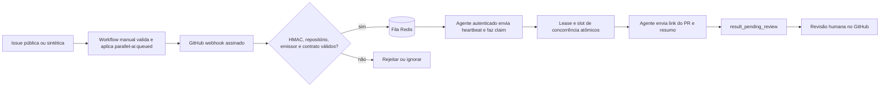
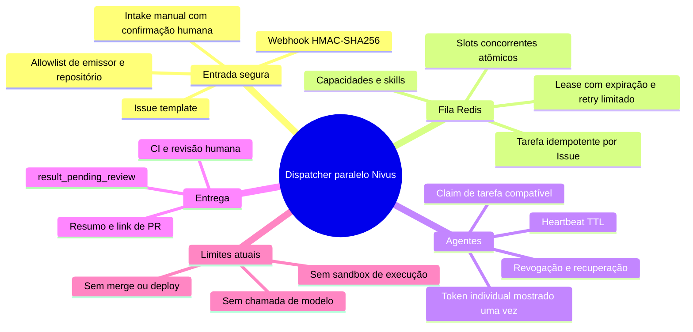

# Dispatcher de desenvolvimento paralelo do Nivus

Este serviço é uma ferramenta externa de desenvolvimento do repositório. Ele não faz parte do runtime do Nivus, não deve ser instalado nos nós de borda e não executa modelos nem código de Issue. A função desta primeira etapa é admitir Issues aprovadas, manter uma fila Redis, reservar uma tarefa para um agente autenticado e receber o link de um pull request para revisão humana.

## Fluxo



## Mapa mental da entrega



Estados de tarefa: `pending → leased → running → result_pending_review`. Um lease expirado volta à fila até três tentativas; ao atingir o limite, fica `failed`. A entrega de um link de PR libera o slot do agente e deixa a tarefa aguardando revisão.

## Requisitos e inicialização

Use Python 3.12 e uma instância Redis privada com persistência habilitada. Esta aplicação chama `EVAL` com scripts Lua para claim, slots, renovação e recuperação de leases; Redis executa cada script atomicamente. O uso de AOF/RDB, volume persistente, backup, autenticação/TLS e política de memória é responsabilidade da instalação Redis. Sem persistência configurada, reiniciar Redis pode perder a fila.

Na raiz do clone do repositório:

```bash
python3 -m venv .venv
. .venv/bin/activate
python -m pip install -r tools/parallel_ai_dispatcher/requirements.txt

export DISPATCHER_REDIS_URL='redis://127.0.0.1:6379/0'
export GITHUB_WEBHOOK_SECRET='valor-aleatorio-com-no-minimo-32-bytes'
export DISPATCHER_ADMIN_TOKEN='token-administrativo-aleatorio-com-no-minimo-32-caracteres'
export GITHUB_WEBHOOK_ALLOWED_REPOSITORIES='astec10/nivus-edge-node'
export GITHUB_WEBHOOK_ALLOWED_ACTORS='github-actions[bot]'

uvicorn tools.parallel_ai_dispatcher.app:app --host 127.0.0.1 --port 8765
```

Guarde os valores reais em um secret manager ou arquivo de ambiente com permissões restritas. Não os inclua em Issues, prompts, logs, imagem ou Git. Publique `/webhooks/github` através de HTTPS; não exponha Redis à Internet. A aplicação falha no startup se faltar qualquer variável obrigatória ou se o Redis não responder.

No GitHub, configure um webhook de repositório para eventos **Issues**, URL HTTPS `/webhooks/github` e um secret forte igual a `GITHUB_WEBHOOK_SECRET`. O workflow manual `parallel-ai-intake.yml` adiciona `parallel-ai:queued` após a confirmação do mantenedor. A aplicação aceita somente o repositório e o emissor configurados; ajuste `GITHUB_WEBHOOK_ALLOWED_ACTORS` se o GitHub entregar o evento por outra conta autorizada.

## API

- `POST /webhooks/github`: valida a assinatura `X-Hub-Signature-256` sobre os bytes originais, limita o corpo a 1 MiB, verifica evento/ação, emissor e repositório, valida novamente o formulário e só admite a aplicação da label `parallel-ai:queued`. `X-GitHub-Delivery` e `(repositório, número da Issue)` evitam duplicatas.
- `POST /admin/agents`: registra capacidades e devolve um token de agente uma única vez.
- `GET /admin/agents`: mostra presença e carga derivadas do Redis.
- `DELETE /admin/agents/{agent_id}`: revoga o agente e devolve suas tarefas ativas à fila, respeitando o limite de tentativas.
- `GET /admin/tasks/{task_id}`: consulta o estado da tarefa.
- `POST /agent/heartbeat`: presença expira se o agente parar de enviar batimentos.
- `POST /agent/tasks/claim`: o agente recebe uma tarefa compatível se houver slot livre.
- `POST /agent/tasks/{task_id}/start`, `/renew` e `/result`: inicia/renova a lease e entrega resumo mais URL de um PR do mesmo repositório.
- `GET /healthz`: verifica a conexão Redis.

As rotas administrativas exigem `Authorization: Bearer <DISPATCHER_ADMIN_TOKEN>`; rotas de agente exigem o token emitido no cadastro. Tokens de agente são aleatórios, apresentados uma vez e persistidos no Redis somente como SHA-256. `active_tasks` não é confiado ao perfil: os slots são conjuntos Redis atualizados dentro do mesmo script atômico da atribuição. A presença online deriva de uma chave com TTL.

### Exemplo de cadastro e ciclo do worker

Cadastre um perfil por operador autenticado. A resposta contém o token individual apenas nessa chamada; guarde-o num secret manager do agente.

```bash
curl -X POST https://dispatcher.example/admin/agents \
  -H 'Authorization: Bearer <DISPATCHER_ADMIN_TOKEN>' \
  -H 'Content-Type: application/json' \
  -d '{"name":"worker-docs-1","provider":"codex","model":"configured-model","specialties":["documentation"],"skill_ids":["nivus-ai-dev-workflow"],"max_concurrent_tasks":1,"backend_type":"remote-api"}'
```

Com `Authorization: Bearer <AGENT_TOKEN>`, o worker chama `POST /agent/heartbeat` a cada 30 segundos e `POST /agent/tasks/claim`. Quando uma tarefa é devolvida, inicia-a com `POST /agent/tasks/{task_id}/start` e o JSON `{"lease_token":"<LEASE_TOKEN>"}`. Durante o trabalho, chama `/renew` antes de a lease expirar. Para devolver o resultado, envia à rota `/result`:

```json
{
  "lease_token": "<LEASE_TOKEN>",
  "result": {
    "summary": "Alteração proposta e critérios atendidos.",
    "pull_request_url": "https://github.com/astec10/nivus-edge-node/pull/123"
  }
}
```

O endpoint confirma apenas o registro do link e muda o estado para `result_pending_review`; o worker continua responsável por abrir um PR legítimo com checks e alterações permitidos.

## Limites desta etapa

- Ainda não existe adaptador para Gemini, OpenAI, Anthropic ou outro provedor, nem executor que crie worktree/container efêmero. O dispatcher fornece o contrato HTTP e a fila; a tarefa não é chamada automaticamente a um modelo.
- O agente precisa enviar heartbeat autenticado antes de conseguir fazer claim. Ele só recebe tarefas cujas skills/especialidades cadastradas cobrem todos os requisitos.
- Esta primeira versão usa distribuição passiva: o worker consulta a fila. Despacho ativo/push e seleção automática de provedor não estão implementados.
- A resposta do agente é um link de PR validado. O sistema não cria, aprova, mescla ou implanta o PR.
- Conteúdo da Issue, labels, resumo do agente e PR são dados não confiáveis. A assinatura prova que o webhook corresponde ao secret configurado; ela não torna as instruções da Issue seguras para execução.
- Uma Issue é admitida uma vez. Uma nova tentativa de negócio deve ser uma nova autorização/Issue; retries técnicos por expiração de lease são limitados a três.
- O webhook valida `X-GitHub-Delivery` e mantém deduplicação por Issue; a assinatura HMAC, por si só, não substitui allowlist de repositório/emissor nem a revisão da Issue.
- Os scripts Redis usam várias chaves e a primeira versão é para uma instância Redis principal, não Redis Cluster. Proteja o Redis com ACL, rede privada, TLS quando cruzar hosts e backup/restore praticado.

## Referências

- [Redis: scripting com Lua e execução atômica](https://redis.io/docs/latest/interact/programmability/eval-intro/)
- [Redis: persistência AOF e RDB](https://redis.io/docs/latest/operate/oss_and_stack/management/persistence/)
- [Redis: operações assíncronas do redis-py](https://redis.io/docs/latest/develop/clients/redis-py/async/)
